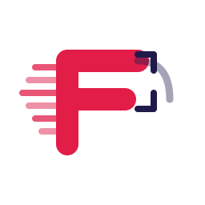
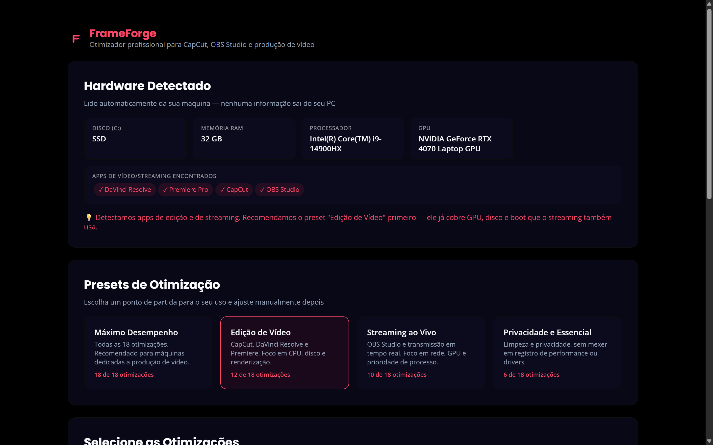
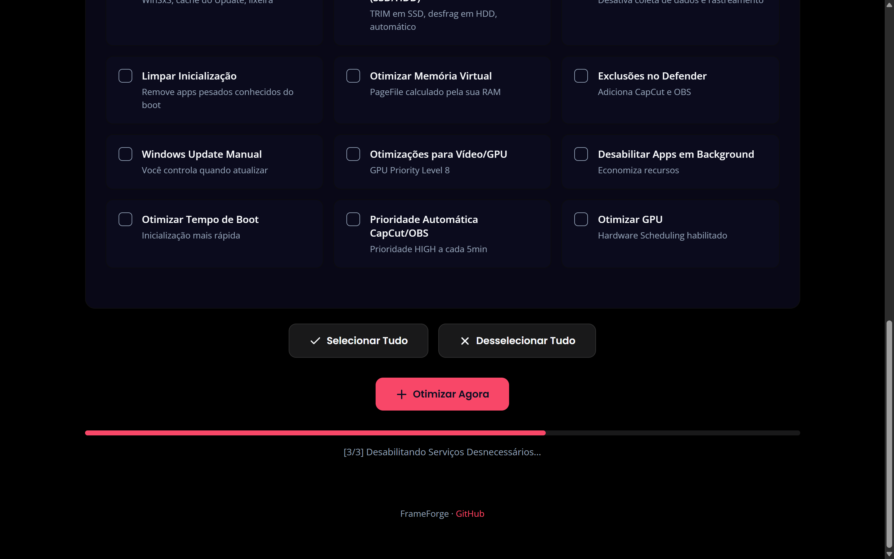

#  FrameForge

<div align="center">


**Professional Windows Optimizer for Video Production**

Forge maximum performance for **CapCut**, **OBS Studio**, **DaVinci Resolve**, **Premiere Pro** and video editing

**18 real optimization modules** · **Auto hardware detection** · **Smart presets** · **Real-time progress**

</div>

---

## Veja em ação

<div align="center">

### Detecção automática de hardware + preset recomendado


### Otimização em tempo real


</div>

---

## Índice

- [O que é](#o-que-é)
- [Destaques](#destaques)
- [O que é otimizado (18 módulos)](#o-que-é-otimizado-18-módulos)
- [Requisitos](#requisitos)
- [Instalação](#instalação)
- [Como usar](#como-usar)
- [Segurança](#segurança)
- [Como reverter](#como-reverter)
- [FAQ](#faq)
- [Licença](#licença)

---

## O que é

FrameForge é um otimizador de Windows com interface web local, focado em quem edita vídeo ou transmite ao vivo (CapCut, DaVinci Resolve, Premiere Pro, OBS Studio). Ele lê o hardware real da sua máquina, sugere um ponto de partida e aplica 18 otimizações reais — cada uma reversível por ponto de restauração.

## Destaques

- **Detecção real de hardware** — SSD/HDD, RAM, CPU, GPU (NVIDIA/AMD/Intel) e quais editores/streaming apps você já tem instalados, lido direto do seu PC (nada sai da máquina)
- **Presets inteligentes** — "Máximo Desempenho", "Edição de Vídeo", "Streaming ao Vivo" e "Privacidade e Essencial", com o melhor já pré-selecionado conforme o que foi detectado
- **18 módulos reais**, cada um testado individualmente de ponta a ponta (não é teoria — veja a seção de módulos)
- **Interface web moderna** com progresso em tempo real via Server-Sent Events
- **Seguro e reversível** — ponto de restauração automático antes de qualquer mudança
- **Validado contra segurança real**: sem CORS aberto, sem injeção de comando, origem restrita a localhost

---

## O que é otimizado (18 módulos)

| Categoria | Módulos |
|---|---|
| **Sistema** | Plano de energia máximo, desabilitar hibernação, 30+ tweaks de registro, otimizar boot |
| **Disco** | Limpeza profunda (WinSxS, cache do Update, lixeira), TRIM automático em SSD / desfragmentação em HDD |
| **Serviços** | Desabilita 12 serviços pesados (telemetria, Xbox, busca, etc.), mantém áudio/vídeo/rede/USB |
| **Privacidade** | Reduz telemetria e rastreamento, Windows Update em modo manual |
| **Memória** | PageFile calculado automaticamente com base na sua RAM |
| **GPU** | Hardware Scheduling, tweaks específicos por fabricante (NVIDIA/AMD) |
| **Rede** | Zero throttling, TCP otimizado para streaming |
| **Apps** | Exclusões no Defender e prioridade automática para CapCut/OBS |
| **Inicialização** | Remove apps pesados conhecidos do boot |

> Todos os 18 módulos foram testados individualmente em hardware real, um por vez, com monitoramento de estabilidade entre cada teste. Dois módulos (limpeza de disco via DISM e exclusões do Defender) são conhecidos por levar mais tempo — a interface avisa quando isso acontece, para não parecer travado.

---

## Requisitos

- **Windows 10** ou **Windows 11**
- **Node.js 14+** ([Download aqui](https://nodejs.org))
- **Permissões de Administrador** (apenas para aplicar as otimizações — a detecção de hardware funciona sem admin)
- **Navegador moderno** (Chrome, Edge, Firefox)

---

## Instalação

### Método 1: Instalação Automática via PowerShell (RECOMENDADO)

**One-liner — Cole no PowerShell como Administrador:**

```powershell
irm https://raw.githubusercontent.com/Paulothedeveloper/FrameForge/main/quick-install.ps1 | iex
```

O instalador vai:
- Verificar e instalar Git e Node.js 14+ (se necessário)
- Clonar o repositório em `%LOCALAPPDATA%\FrameForge`
- Instalar dependências npm automaticamente
- Criar atalho no Desktop e um ponto de restauração do sistema

### Método 2: Instalação Manual

```bash
git clone https://github.com/Paulothedeveloper/FrameForge.git
cd FrameForge
npm install
node server.js
# Acesse: http://localhost:3000
```

Para aplicar otimizações reais, rode `node server.js` numa janela de terminal aberta **como Administrador**.

---

## Como usar

1. Abra `http://localhost:3000` — o hardware é detectado automaticamente em segundos
2. Veja o preset recomendado (ou escolha outro manualmente)
3. Ajuste quais otimizações aplicar individualmente, se quiser
4. Clique em **Otimizar Agora** e acompanhe o progresso em tempo real
5. Ao final, você decide se quer reiniciar o PC (nunca acontece sozinho)

---

## Segurança

- **Ponto de restauração automático** antes de cada execução (com timeout de segurança — nunca trava a otimização indefinidamente)
- **Servidor restrito a localhost**: nenhuma origem externa consegue acionar uma otimização pelo seu navegador
- **Lista fechada de opções válidas** no backend — nenhuma entrada do cliente chega a ser executada como comando
- **Windows Defender permanece ativo** (apenas exclusões de pasta para CapCut/OBS são adicionadas)
- **Nada é desinstalado, nenhum driver é removido, nenhum arquivo pessoal é tocado**

---

## Como reverter

1. Pressione `Win + R`, digite `rstrui.exe`
2. Escolha o ponto de restauração criado pelo FrameForge
3. Restaure o sistema

---

## FAQ

**É seguro usar?** Sim — cria um ponto de restauração antes de qualquer mudança, e todo o código está neste repositório para auditar.

**Preciso ter CapCut/OBS/DaVinci instalados?** Não. O FrameForge detecta o que você tem e recomenda um preset, mas você pode rodar qualquer módulo mesmo sem esses apps instalados.

**Funciona em notebooks?** Sim. O plano de energia é ajustado adequadamente.

**Posso rodar de novo depois?** Sim, quantas vezes quiser.

---

## Licença

MIT — veja [LICENSE](LICENSE).

## Autor

**Paulothedeveloper** — [@Paulothedeveloper](https://github.com/Paulothedeveloper)

<div align="center">

**FrameForge** — Professional Windows Optimizer

</div>
